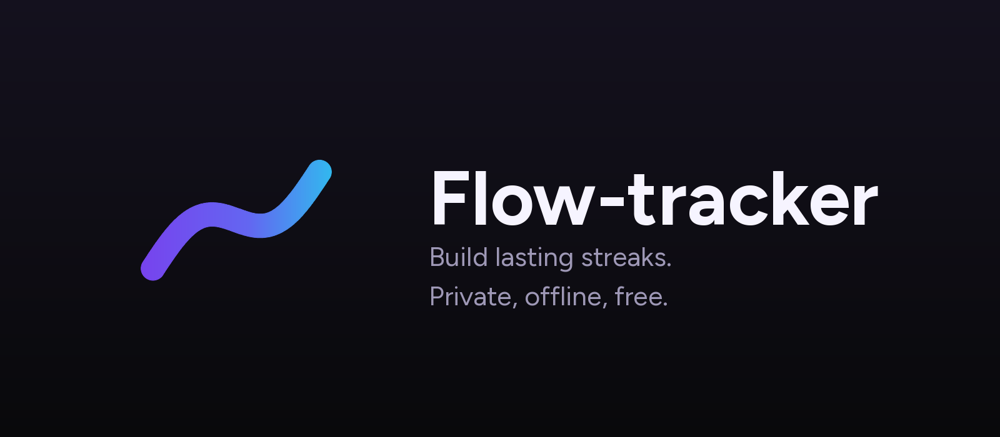

<div align="center">



**Habit tracking that stays on your phone.**

Private · Offline · Free · Open source

Created by **Umaiz Sufiyan**

[](https://github.com/sufiyan-sabeel/flow-tracker/actions/workflows/release.yml)
[](https://github.com/sufiyan-sabeel/flow-tracker/releases/latest)
[](LICENSE)

</div>

---

## What it is

Flow-tracker is a habit tracker for Android built around one idea: the app should
be fast, calm, and completely local. Log a habit in one tap, watch the streak
grow, and see the year fill in. There is no account, no server, no sync and no
analytics — nothing leaves the device, because there is nowhere for it to go.

It is a rebranded, independently released continuation of
[Streak](https://github.com/InlitX/streak) by InlitX. The interface, navigation
and feature set are deliberately kept close to that original, so it feels like
the same app rather than a stranger wearing its clothes.

## Features

**Tracking**

- Habits with a daily, weekly, interval or day-specific schedule, and an optional
  start date for back-dated plans
- Amount habits (glasses, pages, kilometres) with goals and partial progress
- Negative habits ("no sugar") that track days avoided
- Categories, notes and descriptions on every habit
- Archive and restore, so a paused habit keeps its history
- A to-do list with repeating tasks and tags
- Vacation mode that pauses everything at once

**Seeing progress**

- Today dashboard with completion percentage and a week strip
- Streaks: current, best, and perfect-day streaks
- Statistics for week, month and year, plus consistency over time
- Activity heatmap with a rolling or fixed window
- Per-habit history, weekday and hour breakdowns

**Focus**

- A focus timer with custom durations, session history and focus statistics
- Optional habit-linked sessions
- A running-session notification and a focus widget

**On your home screen**

- Widgets for today, stats, the heatmap, focus, to-dos and a focus board
- Configurable background, opacity, border and card style

**Making it yours**

- Three interface styles (classic, minimal, express) over the same data
- Light, dark and system themes
- A true-black AMOLED mode for dark themes
- Colour themes, custom accent colours and a full custom palette
- 28 languages, adjustable text size, and animation controls

**Your data**

- Everything stored locally
- Automatic and manual backup to a zip, plus a readable copy
- Restore, import and export, with integrity checks and safe migrations
- Optional app lock behind biometrics or a PIN

## Install

1. Open the [latest release](https://github.com/sufiyan-sabeel/flow-tracker/releases/latest).
2. Download the APK for your device:

   | File | Use it for |
   | --- | --- |
   | `Flow-tracker-arm64-v8a.apk` | Almost every phone made since ~2017 |
   | `Flow-tracker-armeabi-v7a.apk` | Older 32-bit devices |
   | `Flow-tracker-x86_64.apk` | Emulators and x86 tablets |

3. Allow installs from your browser or file manager when Android asks.
4. Open the APK and install.

Each release ships `SHA256SUMS.txt`. To check a download:

```bash
sha256sum -c SHA256SUMS.txt
```

Requirements: Android 9 (API 28) or newer.

## Screenshots

Fresh screenshots are captured from each published build. The upstream
screenshots were removed rather than shipped with the old branding.

## Development

```bash
git clone https://github.com/sufiyan-sabeel/flow-tracker.git
cd flow-tracker
flutter pub get
flutter run
```

Built and tested with Flutter **3.41.9** (Dart 3.11) and Java 17. Other versions
are untested; the CI pins those exact versions.

Useful commands:

```bash
flutter analyze          # static analysis, must be clean
flutter test             # the full test suite
flutter build apk --release --split-per-abi
```

Localisation is generated from `lib/l10n/*.arb` by `flutter gen-l10n`, which
`flutter pub get` runs for you. English is the template; missing keys fall back
to it.

## Architecture

```
lib/
  app/          app root, shell, navigation, theme, background
  core/         database, routing, i18n, shared widgets, utilities
  features/     habits, statistics, focus, todos, settings, onboarding, island
  services/     notifications, backup, import/export, widgets, folder sync
  l10n/         ARB sources and generated localisations
android/        Flutter Android host, Kotlin/Glance home-screen widgets
test/           68 test files covering logic, widgets and storage
```

- **State**: `provider` with `ChangeNotifier` controllers per feature.
- **Storage**: Hive documents plus a local file layer; no network code paths.
- **Widgets**: Kotlin with Jetpack Glance and RemoteViews, fed by a payload the
  app writes and the widget actions queue back.
- **Theming**: `ColorScheme` derived from an accent seed, with per-style theme
  builders and an optional pure-black surface set for AMOLED.

## Licence

Flow-tracker is free software under the **GNU General Public License, version 3
only**, with the additional terms of its section 7. See [LICENSE](LICENSE) and
[ADDITIONAL_TERMS.md](ADDITIONAL_TERMS.md). There is no warranty.

## Upstream attribution

Flow-tracker is based on **Streak** by **InlitX**
(https://github.com/InlitX/streak), used under the GPL-3.0 and its section 7
additional terms.

> Based on Streak by InlitX

The upstream copyright notices, licence text and additional terms are retained
in this repository unmodified. See [NOTICE.md](NOTICE.md) for the full
provenance statement and what changed in the fork.

## Reporting issues

Use the [issue tracker](https://github.com/sufiyan-sabeel/flow-tracker/issues).
A phone model, Android version and the steps that led to the problem make a fix
much faster. Please do not report Flow-tracker problems to the upstream project.
